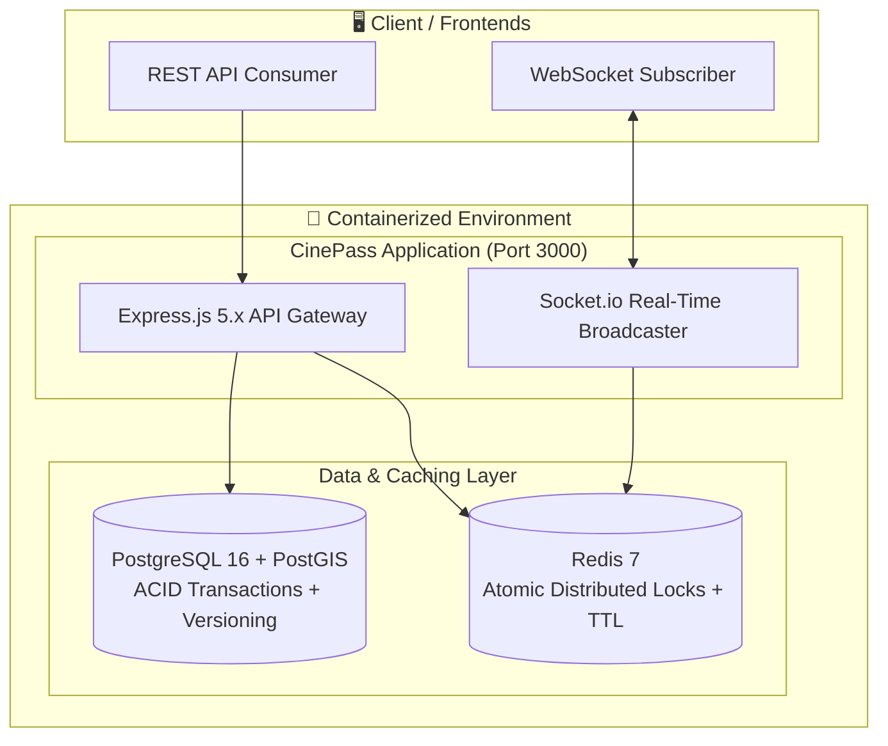

# 🎬 CinePass — Scalable Distributed Movie Ticket Booking System

A production-grade, highly scalable movie ticket booking backend engineered with **Node.js, Express.js, PostgreSQL, Redis, Socket.io, and Stripe**, fully containerized via **Docker**.

Built with a strong focus on **High Concurrency, Distributed Locking (Race Condition Elimination), and Geospatial Proximity Discovery**.

---

## 🏗️ System Architecture



---

## ⚡ Key Highlights & Interview Engineering Decisions

### 1. 🛡️ Two-Phase Concurrency Control (Race Condition Elimination)
- **Phase 1 (Seat Selection):** 
  Uses **Redis `SET ... EX ... NX` (SETNX with TTL)** to atomically acquire in-memory distributed locks in microseconds without overwhelming the relational database.
- **Phase 2 (Payment & Confirmation):**
  Executes an ACID database transaction utilizing **Optimistic Concurrency Control (OCC)** via a `version` column and a unique constraint `@@unique([showId, seatId])` in PostgreSQL.
- **Safe Release:** Lock releases are executed via atomic **Lua scripts** ensuring users can only release their own locks.

### 2. 📍 Location-based Proximity Search
- Implements the **Spherical Haversine Distance Formula** directly at the PostgreSQL database level using raw geospatial SQL queries.
- Cinema halls are sorted by real-world distance (km) relative to user coordinates.

### 3. 💳 Stripe Payment Integration with Idempotency
- Price calculation is strictly enforced on the server.
- Uses **Raw Buffer Webhooks** for cryptographic signature verification.
- Enforces database-level idempotency (`stripePaymentId @unique`) against duplicate event deliveries.

### 4. 📡 Real-time Seat Availability via WebSockets
- Socket.io **Room-based architecture** (`show:<showId>`) broadcasts state changes (`seat:locked`, `seat:booked`) only to clients currently viewing that particular show.

### 5. 🐳 Zero-Configuration Docker Setup
- Multi-stage Dockerfile producing a minimal Alpine production image (~120MB) running as a non-root user.
- Docker Compose orchestrates Node.js, PostgreSQL with PostGIS, and Redis with healthchecks and internal DNS resolution.

---

## 📦 Tech Stack

- **Runtime:** Node.js 22 LTS
- **Framework:** Express.js 5.x
- **Database:** PostgreSQL 16 + PostGIS
- **ORM:** Prisma 6.x
- **In-Memory Cache & Locking:** Redis 7 / ioredis
- **Real-Time Engine:** Socket.io
- **Payment Gateway:** Stripe API
- **Authentication:** JWT (JSON Web Tokens) + Bcrypt password hashing
- **Input Validation:** Zod
- **Logging & Observability:** Winston (Structured JSON / Rotating File Transports)
- **Containerization:** Docker & Docker Compose

---

## 🚀 Quick Start (Docker)

Run the entire distributed system with a single command:

```bash
# 1. Clone the repository
git clone https://github.com/<your-username>/cinepass.git
cd cinepass

# 2. Setup environment variables
cp .env.example .env

# 3. Spin up all containers
docker-compose up -d --build

# 4. Seed database with demo data (Cinema halls, screens, seats, movies, shows)
docker-compose exec app npm run db:seed
```

The application will be accessible at:
- **API Server:** `http://localhost:3000`
- **Health Check:** `http://localhost:3000/health`
- **WebSocket Gateway:** `ws://localhost:3000`

---

## 📂 Project Structure

```
cinepass/
├── docker-compose.yml          # Multi-container orchestration
├── Dockerfile                   # Multi-stage production Dockerfile
├── prisma/
│   ├── schema.prisma            # Relational database schema & indexes
│   └── seed.js                  # Automated demo database seeding
├── src/
│   ├── app.js                   # Express pipeline & middleware configuration
│   ├── index.js                 # HTTP + WebSocket server & graceful shutdown
│   ├── config/
│   │   ├── database.js          # Singleton Prisma Client & connection pool
│   │   ├── redis.js             # Atomic SETNX locking & Lua release scripts
│   │   ├── socket.js            # Socket.io room broadcasts
│   │   ├── stripe.js            # Stripe SDK configuration
│   │   └── logger.js            # Winston structured logger
│   ├── middleware/
│   │   ├── auth.js              # JWT Bearer token authentication
│   │   ├── errorHandler.js      # Centralized error handling
│   │   ├── rateLimiter.js       # IP rate limiting
│   │   └── validate.js          # Zod request validation
│   ├── modules/
│   │   ├── auth/                # User register, login & profile
│   │   ├── cinema/              # Location-based cinema discovery
│   │   ├── movie/               # Movie catalog & showtime scheduling
│   │   ├── booking/             # Seat locking, race handling & checkout
│   │   └── payment/             # Stripe payment intents & webhooks
│   └── utils/
│       ├── apiError.js          # Standardized HTTP error class
│       ├── apiResponse.js       # Unified API response wrapper
│       └── constants.js         # Status enums and constants
```

---

## 📝 API Endpoints Summary

### Auth
- `POST /api/v1/auth/register` — Register a new user
- `POST /api/v1/auth/login` — Login & receive JWT token
- `GET /api/v1/auth/profile` — Get current user profile (Protected)

### Cinema Halls (Geospatial)
- `GET /api/v1/cinemas/nearby?lat=28.63&lng=77.21&radius=25` — Get nearest cinemas sorted by distance
- `GET /api/v1/cinemas/:id` — Get cinema details and active screens

### Movies & Shows
- `GET /api/v1/movies?genre=Sci-Fi&search=Inception` — Paginated movie catalog
- `GET /api/v1/movies/:id` — Movie details
- `GET /api/v1/movies/:id/shows?date=2026-10-20` — Show timings for a movie

### Bookings (Concurrency Controlled)
- `GET /api/v1/bookings/shows/:showId/seats` — Real-time seat availability
- `POST /api/v1/bookings/lock-seats` — Lock seats for 5 mins via Redis (Protected)
- `POST /api/v1/bookings/confirm` — Confirm booking via ACID transaction (Protected)
- `GET /api/v1/bookings/my-bookings` — View user's booking history (Protected)

### Payments
- `POST /api/v1/payments/create-intent` — Generate Stripe client secret (Protected)
- `POST /api/v1/payments/webhook` — Stripe webhook receiver (Raw body)

---

## 📄 License
MIT
